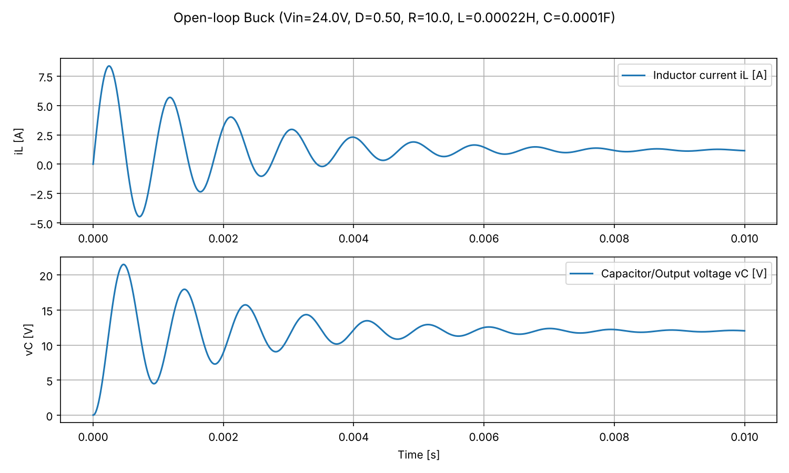
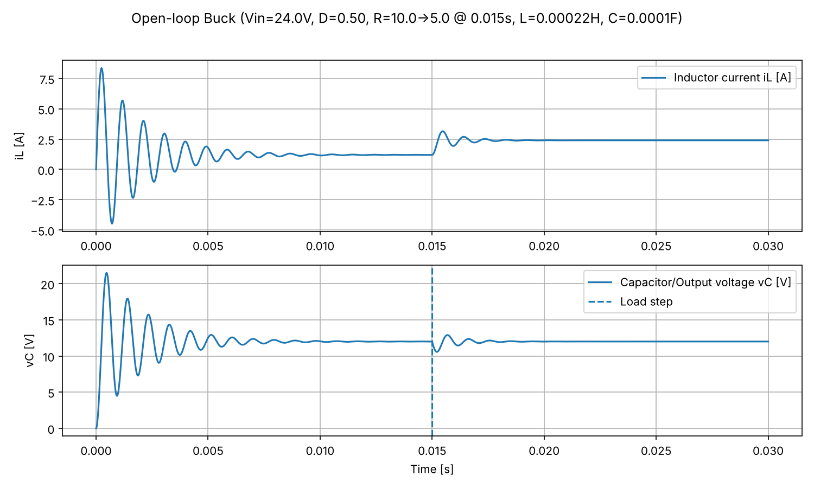

# Buck Converter Simulation (Python)

An averaged state-space model of a DC–DC buck converter. It simulates start-up and load-step transients, reports the steady-state output, and saves the waveforms as plots.



## What it models

The converter is represented by its two energy-storage states: inductor current *i<sub>L</sub>* and capacitor (output) voltage *v<sub>C</sub>*. Switching is averaged over each period, so the duty ratio *D* acts as a continuous input:

```
L · diL/dt = D·Vin − vC
C · dvC/dt = iL − vC / R(t)
```

The equations are integrated with SciPy's `solve_ivp`. The load *R(t)* can step from `R` to `R2` part-way through a run to test the converter's response to a sudden change in load.

## Results (default parameters)

Vin = 24 V, D = 0.5, L = 220 µH, C = 100 µF, R = 10 Ω

| Metric | Value |
|---|---|
| Steady-state output | 12.00 V (matches the ideal D·Vin = 12 V) |
| Steady-state inductor current | 1.20 A |
| LC resonant frequency, f₀ = 1 / (2π√LC) | ≈ 1.07 kHz |
| Damping ratio, ζ = (1/2R)·√(L/C) | ≈ 0.074 (very lightly damped) |
| Start-up overshoot | ≈ 79 % (peaks at ≈ 21.5 V) |
| Peak inductor current at start-up | ≈ 8.4 A |
| 2 % settling time | ≈ 7.6 ms |

**Load step (R: 10 Ω → 5 Ω at t = 15 ms)**

| Metric | Value |
|---|---|
| Output voltage dip | ≈ 1.4 V (≈ 12 %) |
| Recovery to within 2 % | ≈ 1.8 ms |
| New inductor current | 2.40 A |



### What this shows
- **Open-loop regulation works on average.** With no feedback, the output settles at D·Vin, but only because the model is ideal and lossless.
- **The LC filter is badly under-damped at this load.** The start-up overshoot (≈ 79 %) and the inductor current peak (≈ 7× steady state) would stress real components. That makes the case for soft-start and closed-loop control.
- **Load changes disturb the output.** The voltage rings at the LC resonant frequency before settling. A feedback controller would reject the disturbance faster and hold the output closer to its setpoint.

## Usage

```bash
pip install -r requirements.txt

python Buck_Converter.py                                         # defaults: Vin=24 V, D=0.5, R=10 Ω
python Buck_Converter.py --duty 0.45 --R 8                       # different operating point
python Buck_Converter.py --R 10 --R2 5 --load-step-time 0.015 --t_end 0.03   # load step
```

| Option | Default | Meaning |
|---|---|---|
| `--Vin` | 24.0 | Input voltage [V] |
| `--duty` | 0.5 | Duty ratio D (clipped to 0–1) |
| `--R` | 10.0 | Load resistance [Ω] |
| `--R2` | – | Load resistance after the step [Ω] |
| `--load-step-time` | – | Time of the load step [s] |
| `--L` | 220e-6 | Inductance [H] |
| `--C` | 100e-6 | Capacitance [F] |
| `--t_end` | 0.01 | Simulation length [s] |
| `--max_step` | 1e-5 | Maximum solver step [s] |

Each run prints a steady-state summary and saves a timestamped plot in `results/`.

## Assumptions and limitations
- Averaged model: switching ripple is not shown.
- Ideal, lossless components (no ESR, switch or diode losses).
- Continuous conduction is assumed throughout, as if the converter were synchronous. The inductor current is allowed to go negative during start-up, which a diode-based converter could not do.

## Next steps
- [ ] Closed-loop PI voltage control with output saturation and integrator anti-windup
- [ ] Step-response metrics (overshoot, settling time) calculated automatically in the script
- [ ] Soft-start duty ramp to limit start-up overshoot and inrush current
- [ ] Add ESR and switch losses; compare with a switched (non-averaged) model

## Tools
Python · NumPy · SciPy (`solve_ivp`) · Matplotlib

## Author
Gabriel Hossenboccus, BEng Electrical & Electronic Engineering, Newcastle University
